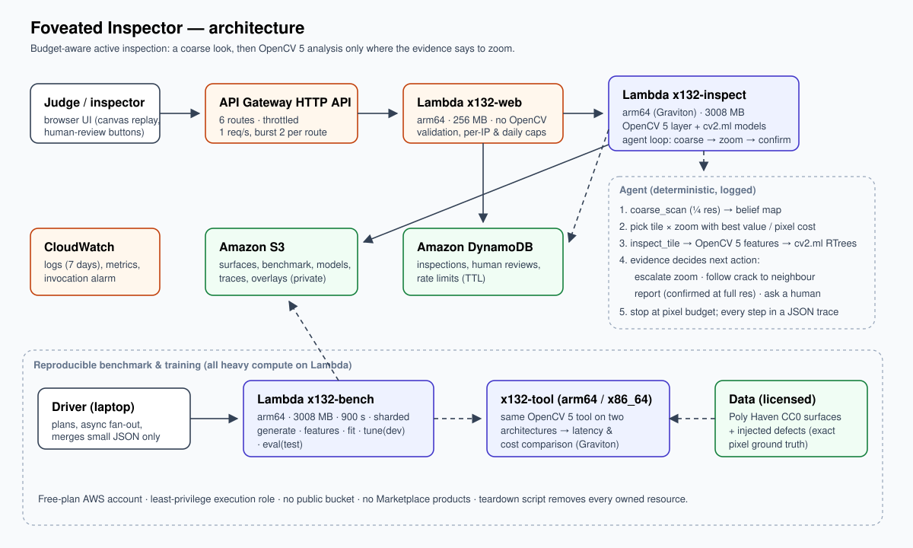

# Foveated Inspector

**Budget-aware active visual inspection with OpenCV 5 on AWS.**
An inspection agent that looks at a very large surface photo the way a human inspector does: glance at the whole thing, zoom only where the evidence says to, follow a crack into the next tile, confirm at full resolution, and hand anything uncertain to a person — instead of analysing every pixel at full resolution. The name comes from the fovea of the eye, which sees sharply only at the centre of gaze.

Entry for the *OpenCV AI Competition 2026, powered by AWS* (Agentic Vision path). Team: Driedsandwich (solo).

- Live demo (throttled, daily cap): https://s041j0ehzk.execute-api.us-east-1.amazonaws.com
- Video (≤ 5 min): `[TBD]`
- Technical report: [`docs/TECHNICAL_REPORT.md`](docs/TECHNICAL_REPORT.md)

## Why

High-resolution inspection images (drone surveys of bridge decks, line-scan cameras over walls and pavements) are large, and most of the surface is defect-free. Running a full-resolution detector everywhere costs time and money, and it also produces more false alarms on busy textures. The question this project measures: **how much of the full-resolution analysis can an agent skip while still finding the defects, and does it stay honest about what it did not check?**

## How it works

1. **Coarse scan** (¼ resolution, OpenCV 5): multi-scale morphology, Hessian ridge strength, Gabor energy, Lab colour deviation, normalised by robust statistics of the same surface → a belief map over a 16×16 grid.
2. **Choose the next look**: the agent picks the tile and zoom level (¼, ½, full) with the highest defect belief per full-resolution pixel that look would cost.
3. **Inspect the tile** (`inspect_tile`, OpenCV 5 + `cv2.ml` RTrees per scale): patch features → defect probability map → connected components → candidate defects with kind, length and width.
4. **The evidence decides the next action**: escalate the same tile to a higher zoom when ambiguous; follow a crack whose endpoint touches the tile border into the neighbouring tile; report a defect only after confirming it at full resolution; send it to a human-review queue when still ambiguous.
5. **Stop** when the pixel budget is spent or no remaining tile is likely enough. Every step (reason, observation, belief before/after, pixel cost) is written to a JSON trace that the web UI replays.

The agent is a deterministic, inspectable policy — no generative model is involved, and every decision can be audited from the trace.

## Results (held-out test surfaces with synthetic defects: 28 images, 155 defects, 4096 × 4096)

The image is a 16 × 16 grid of 256 × 256-pixel cells. *Defect-cell recall* is the share of defects that a flagged cell covers; *flag precision* is the share of flagged cells that actually contain a defect.

| Method | Full-res budget | Defect-cell recall | Cells flagged | Flag precision | False alarms / image | Pixels analysed |
|---|---|---|---|---|---|---|
| Active agent | 5 % | 19.4 % | 0.6 % | **87.5 %** | 0.7 | 12.8 % |
| Active agent | 40 % | 30.3 % | 1.8 % | **42.9 %** | 4.4 | 47.8 % |
| Coarse only (¼) | — | 34.8 % | 6.7 % | 20.4 % | 14.5 | 7.8 % |
| Random cells | 40 % | 29.7 % | 12.5 % | 8.3 % | 45.6 | 47.7 % |
| Exhaustive full-resolution | 100 % | 70.3 % | 31.9 % | 8.6 % | 116.8 | 107.8 % |

At the same 40 % budget the agent's defect-cell recall is about the same as random cells' while it flags seven times fewer cells, so its flags are about five times as likely to be right. Recall is the open problem: the agent finds only 19–30 % of the defects, a hand-crafted OpenCV detector under the same policy does about as well (33.5 % defect-cell recall and 55.2 % flag precision at 40 %), and the detector trained on synthetic defects does not yet transfer to real crack photographs (52.9 % accuracy on 2,000 real patches, close to chance on this balanced set). Full details, trade-off tables and the results we withdrew are in the technical report.

Arm (Graviton) vs x86_64 Lambda, same OpenCV 5 tool on the same tiles (warm, 3 tiles × 3 runs): median execution 38.9 ms vs 36.7 ms; median billed 39 ms vs 37 ms — about the same. Cost was not measured. Small sample — see the report.

## Architecture



- **Public path**: API Gateway HTTP API (throttled per route) → `x132-web` (256 MB, no OpenCV: validation, per-IP and daily caps) → `x132-inspect` (arm64, 3008 MB, OpenCV 5 layer + models).
- **Storage**: S3 (private; surfaces, benchmark, models, traces, overlays), DynamoDB (inspections, human reviews, rate limits with TTL), CloudWatch (logs kept 7 days, invocation alarm).
- **Benchmark & training**: all heavy computation runs on Lambda (`x132-bench`, sharded); the laptop only plans, fans out and merges small JSON files.

## Data and evaluation

- Backgrounds: 14 photographed concrete surfaces from [Poly Haven](https://polyhaven.com) (CC0), 4096 × 4096. Development and test surfaces are disjoint (7 / 7).
- Defects (crack, spall, efflorescence, rust stain) are injected with exact pixel ground truth; each defect's contrast is calibrated against its local texture (SNR ≥ 1.3), and the scale at which it becomes visible is recorded.
- Detector training, hard-negative mining and policy tuning use development surfaces only. We did look at test results of two withdrawn versions during development (see the technical report, section 7), so the test set is not untouched.
- Independent real-data check: 1,000 crack and 1,000 non-crack patches from Özgenel (2019), CC BY 4.0 — the full-resolution model labels 98.0 % of crack patches and 92.2 % of non-crack patches as defective (accuracy 52.9 %); it was not trained on real data.

## Reproduce

Requirements: Python 3.12, `uv`, an AWS account (the project was built on a Free-plan account), credentials in the standard AWS SDK chain.

```sh
python -m venv .venv && .venv/bin/pip install opencv-contrib-python-headless==5.0.0.93 boto3
.venv/bin/python -m unittest discover -s tests          # offline unit tests, synthetic inputs only
bash aws/build_layer.sh --arch all --glibc 2.28        # Lambda layers (Linux wheels, no Docker)
.venv/bin/python aws/deploy.py --bench-only --execute   # private benchmark worker
# then follow docs/REPRODUCE.md: upload surfaces → generate → features → fit → hard negatives → refit → tune (dev) → eval (test)
.venv/bin/python aws/deploy.py --execute --model-dir <models> --samples-manifest aws/samples.example.json
.venv/bin/python aws/teardown.py --execute              # removes every resource it created
```

## Responsible use and limits

- This is a triage aid, not a safety certification. Uncertain areas go to a human; the trace shows exactly which parts of the image were never examined at full resolution.
- The benchmark defects are synthetic on real photographed backgrounds; evidence on real defects is limited to the patch-level check and qualitative runs on real cracked surfaces.
- The public demo is rate-limited and capped per day; uploaded images expire after one day. No people or personal data are involved.

## AI disclosure

The code was written with AI coding assistants (OpenAI Codex and Anthropic Claude Code) under human direction. The agent inside the product is a rule-based policy; it does not call a generative model.

## Credits

- Surface photos: Poly Haven, CC0 — *Powered by Poly Haven*.
- Real crack patches: Ç. F. Özgenel, "Concrete Crack Images for Classification", Mendeley Data, V2 (2019), doi:10.17632/5y9wdsg2zt.2, CC BY 4.0.
- OpenCV 5 (Apache 2.0).
